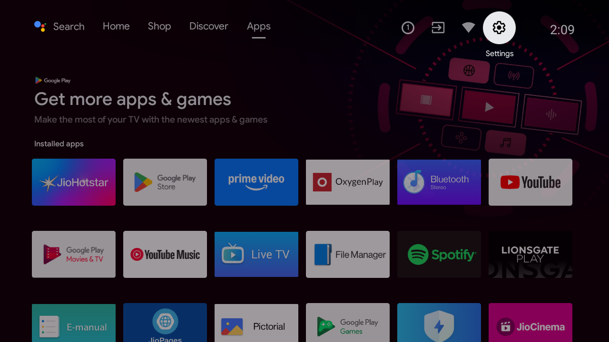
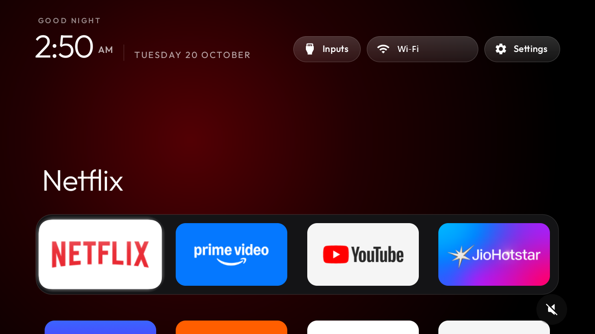
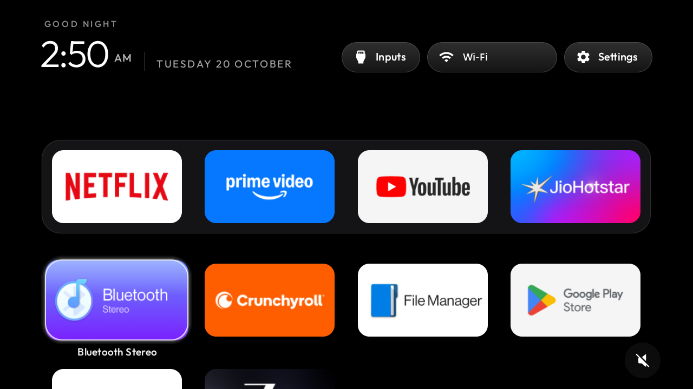

# Clean TV and laptop

Two cleanups, both done step by step, with a backup or a read-only check first:

- **This page:** a OnePlus TV Y1S, debloated, with its ad-filled home screen replaced by a light, Apple TV
  style launcher.
- **[`laptop/`](laptop/README.md):** an HP OMEN 16 that felt slow. It covers the diagnosis, what
  was removed, what to watch, the scripts, and lessons learned.

| Before | After |
|---|---|
|  |  |
| |  |

# TV: OnePlus TV Y1S

The OnePlus TV Y1S (model D00 "Dubai", Android TV 11, firmware RTM1.210315.027, IP `192.168.1.7`)
with the bloat switched off and the ad-filled home screen replaced by a clean, Apple TV style launcher.

Nothing was uninstalled, rooted or flashed. Every app was **disabled** (`pm disable-user --user 0`),
and one command undoes all of it.

## What was done

| | |
|---|---|
| Backup | `backup/00-original/`: package lists, disabled list, `getprop`, all settings, Home and input state, taken before anything changed. `backup/01-after-setup/` is the same snapshot afterwards. Both stay on the PC and are **not in this repo**, because they contain the TV's serial number, Android ID and Bluetooth address. Run `tools/backup.py` to make your own. |
| Debloat | 27 packages disabled, listed and explained in [`debloat.txt`](debloat.txt): OnePlus/Google telemetry, OxygenPlay and partner auto-installs, Smart Manager, ONet, Assistant, Miracast, the remote updater, both stock screensavers, preloads you didn't want, Spotify, JioCinema, Airtel Xstream, Lionsgate Play, and the stock home with its recommendation rows. |
| Kept | Live TV and the source list, HDMI/AV/tuner inputs, remote and Bluetooth, Gboard, Play Store and Play Services, TV Settings, system updates, Chromecast, File Manager, Bluetooth Stereo, Netflix, Prime Video, YouTube, YouTube Music, JioHotstar, ZEE5, Crunchyroll. |
| Ad-blocking DNS | Private DNS set to `dns.adguard-dns.com`. It blocks ad and tracker domains in most apps, **but not YouTube ads**, and AdGuard sees the TV's DNS lookups. |
| Launcher | `com.gathin.tvhome`, built from `launcher/` (MIT, from [Gathin23/cleanyourtv](https://github.com/Gathin23/cleanyourtv)), set as Home. The Clock screensaver is set too. |

Already disabled before we started and left that way: `com.heytap.olink`, `com.oneplus.tv.remote`.

Tested on the TV after a reboot: Home opens the new launcher, every disabled app stayed disabled,
YouTube plays with the DNS on, and Inputs → HDMI 1 switches the input. With the real remote: the
Input button opens the TV's source list, Home returns to the launcher from inside an app, and the
Netflix / Prime Video / YouTube buttons open their apps.

## Before you put the remote down

**Switch USB debugging off:** Settings → Device Preferences → Developer options → USB debugging.
The launcher, the debloat and the DNS all keep working without it. Switch it on again only when you
want to run one of the scripts below (the TV then asks "Allow USB debugging?" once more if the key
was forgotten). Your USB ports were empty, so nothing lost power while it was on.

## The scripts

Run these from this folder in PowerShell. They talk to the TV over Wi-Fi with the Python ADB client
in `tools\venv`, so USB debugging must be on. They default to `192.168.1.7`; if the TV gets a new IP
address, add `-TvHost <new ip>`. The first run creates an ADB key pair in `tools\adbkey\` and the TV
asks "Allow USB debugging?". That key is private: `.gitignore` keeps it, the `backup\` snapshots and
the raw `screens\` out of git.

| Script | What it does |
|---|---|
| `powershell -ExecutionPolicy Bypass -File tools\restore.ps1` | **Undo everything:** re-enables all 27 packages, gives Home back to the stock launcher, and resets Private DNS, the screensaver and the animation speed to how they were. Add `-UninstallLauncher` to remove the new launcher too. |
| `powershell -ExecutionPolicy Bypass -File launcher\build-and-install.ps1` | **Build and install the launcher** and make it Home. It starts the launcher before disabling the stock one, checks where Home lands, and re-enables the stock launcher if it isn't the new one. Run it again after you change `config.xml`. |
| `tools\venv\Scripts\python.exe -I tools\disable.py` | Re-apply the debloat list (batches 1–6). Add batch numbers to apply only those, e.g. `... disable.py 5 6`. |
| `powershell -File tools\tv.ps1 "<command>"` | Run one shell command on the TV. |
| `powershell -ExecutionPolicy Bypass -File tools\theme.ps1 themes\my-tv` | Change the dock or wallpaper without rebuilding (see below). `-Reset` goes back to the built-in settings. |
| `tools\venv\Scripts\python.exe -I tools\backup.py` | Take a fresh snapshot into `backup\<date-time>\`. |
| `tools\venv\Scripts\python.exe -I tools\shot.py <name> HOME DPAD_DOWN ...` | Press remote keys and save a screenshot to `screens\<name>.png`. |

## Re-enabling an app

One app, from the PC (package names are in `debloat.txt`):

```powershell
powershell -File tools\tv.ps1 "pm enable --user 0 com.spotify.tv.android"
```

Then delete or comment out (`#`) its line in `debloat.txt`, so a later `disable.py` or `restore.ps1`
run matches what you want.

Without a PC: on the TV, Settings → Apps → See all apps → Show system apps → pick the app → Enable.

Useful ones to know:

| If you want back... | Enable |
|---|---|
| Google Assistant / the mic button | `com.google.android.katniss` |
| Miracast screen mirroring | `com.heytap.optvmiracastservice` and `com.mediatek.androidbox` |
| OnePlus remote firmware updates | `com.heytap.oprcupgradeservice` |
| The stock home screen | run `tools\restore.ps1`, or enable `com.google.android.tvlauncher` |
| Ambient-mode screensaver | `com.google.android.backdrop`, then pick it in Settings → Device Preferences → Screen saver |

The OnePlus Settings panel shows an "Interconnection service has been closed" card because ONet is
off. Dismiss it with its ✕; it's only a notice.

## Changing the dock order

**Quick way, no rebuild.** Edit [`themes/my-tv/config.json`](themes/my-tv/config.json): `dock_apps` is
the dock from left to right. Then push it:

```powershell
powershell -ExecutionPolicy Bypass -File tools\theme.ps1 themes\my-tv
```

Package names of your apps:

| App | Package |
|---|---|
| Netflix | `com.netflix.ninja` |
| Prime Video | `com.amazon.amazonvideo.livingroom` |
| YouTube | `com.google.android.youtube.tv` |
| JioHotstar | `in.startv.hotstar` |
| YouTube Music | `com.google.android.youtube.tvmusic` |
| ZEE5 | `com.graymatrix.did` |
| Crunchyroll | `com.crunchyroll.crunchyroid` |
| File Manager | `com.heytap.tv.filebrowser` |
| Bluetooth Stereo | `com.heytap.tv.btspeaker` |
| Play Store | `com.android.vending` |

For an app installed later, list all names with `powershell -File tools\tv.ps1 "pm list packages -3"`.

**Permanent way.** Edit `dock_apps` in `launcher/app/src/main/res/values/config.xml` and run
`launcher\build-and-install.ps1`. A pushed theme overrides `config.xml` until you run `theme.ps1 -Reset`.

## Changing the wallpaper

Put a dark 1920×1080 JPEG under about 300 KB at `themes/my-tv/wallpaper.jpg`. Keep it dark: the
text and dock are designed for black, and the TV decodes the picture on every Home start. Then push:

```powershell
powershell -ExecutionPolicy Bypass -File tools\theme.ps1 themes\my-tv
```

To try the ready-made one: `tools\theme.ps1 themes\aurora`. Back to pitch black: delete the
`wallpaper.jpg` from `themes/my-tv` and push again, or run `tools\theme.ps1 -Reset`. You can also
set `"background_color": "#RRGGBB"` in the theme's `config.json`. Other keys (columns, rows under
the dock, reduced motion) are listed in [`themes/README.md`](themes/README.md).

## Ad-blocking DNS

Turn it off (back to Android's automatic DNS):

```powershell
powershell -File tools\tv.ps1 "settings put global private_dns_mode opportunistic"
```

Do this if an app stops loading or the TV reports "No internet" while other devices are fine; it
means the AdGuard resolver is down or unreachable. Turn it on again with `private_dns_mode hostname`.

## Using the launcher

- **Dock:** your four apps. The focused one's name shows above it, over a glow in the app's colour.
- **Down:** into the grid of the other apps, one row per press. **Up** from the dock goes to the
  buttons at the top.
- **Inputs:** HDMI 1, HDMI 2, AV and Live TV (the firmware also registers VGA and Component inputs
  this set doesn't have, so they're filtered out with `hidden_inputs` in `config.xml`).
- **Wi-Fi pill:** shows the network name and opens network settings. **Settings:** the TV's settings.
- **Home** from inside an app returns to the tile you opened it from. Pressing Home again while
  you're already on the home screen jumps back to the first dock tile.
- **Clock screensaver:** already selected; it drifts so nothing burns in.

## Changes made to the upstream launcher

The launcher in `launcher/` is cleanyourtv's, with these changes for this TV:

- `config.xml`: Live TV package `com.heytap.tv.livetv` (hidden from the grid, reached through Inputs).
- New `hidden_inputs` setting (`config.xml` and theme `config.json`) that drops inputs the
  firmware registers but the set has no socket for: VGA and Component here.
- The composite input is labelled **AV**, as on the TV's own source list.
- Home pressed inside an app keeps the last focused tile; upstream reset focus to the first dock
  tile on every Home press.
- `build-and-install.ps1`: defaults to this TV and the portable toolchain, and disables the stock
  launcher's recommendation helpers once Home is confirmed.
- Lighter on memory, for this 1 GB set:
  - Each app's banner is drawn once at tile size (264×149 px at most) and cached until that app is
    updated, instead of every banner being re-read from its APK at xhdpi on every Home press.
  - When Android reports memory is tight while you're in an app, the launcher drops its artwork so
    the app in front gets the RAM back. Home rebuilds it on return.
  - Module cards are off (`module_cards` in `config.xml`), so there's no card lookup on every Home press.

  Measured on the TV: Home appears in 0.2–0.5 s after leaving an app, down from 2.7 s on the first
  press, and the launcher holds about 46 MB (down to about 40 MB under memory pressure) while an
  app is in front.

## Speed

The TV has 920 MB of RAM, so it slows down when big apps pile up in memory: JioHotstar takes about
125 MB and Netflix about 110 MB (Netflix keeps itself running on purpose, which is why it reopens
almost instantly). What was done:

- System animations are set to 0.5× (window, transition and animator). Back to the original speed:
  `tools\tv.ps1 "settings put global window_animation_scale 1.0"`, the same for
  `transition_animation_scale` (1.0) and `animator_duration_scale` (0.6). `restore.ps1` does this too.
- The launcher changes above.
- App caches were cleared (`pm trim-caches`), which took free storage from 1.2 GB to 2.1 GB. Apps
  rebuild their caches as you use them; run `tools\tv.ps1 "pm trim-caches 8G"` again any time storage fills up.
- **Play Store auto-updates are off**, so app updates no longer run in the background. Update by hand
  every few weeks: Play Store → your profile picture → Manage apps and games → Updates. To switch
  auto-updates back on: Play Store → profile picture → Settings → Auto-update apps.
- Left alone on purpose: `com.heytap.tvapiservice` (about 23 MB). It runs a Bluetooth link service that
  most likely looks after the remote, so it isn't worth the risk.

The first few minutes after the TV is switched on from the wall are always slower, because the
system and Play Services start everything up.

## Rebuilding on a new PC

The build uses a portable JDK 17 and Android SDK (platform 34, build-tools 34.0.0) unpacked in
`%LOCALAPPDATA%\cleantv-toolchain`, with no system-wide install. On another PC, install Android
Studio (or set `JAVA_HOME` and `ANDROID_HOME`), then:

```powershell
python -m venv tools\venv; tools\venv\Scripts\python.exe -m pip install -r tools\requirements.txt
powershell -ExecutionPolicy Bypass -File launcher\build-and-install.ps1
```

## Notes

- If Home ever shows "Select a Home app" (for example after a restore and then re-applying the
  list), pick the launcher on the TV or run `launcher\build-and-install.ps1` again.
- A firmware update may re-enable a package. Run `tools\venv\Scripts\python.exe -I tools\disable.py`
  to apply the list again.
- Screenshots from the PC come out empty while HDMI, Live TV or Netflix is on screen. That's the
  TV protecting video, not a fault.
- Credits: launcher and tools from [Gathin23/cleanyourtv](https://github.com/Gathin23/cleanyourtv),
  MIT licence (`LICENSE-cleanyourtv.txt`). The Outfit typeface is under the SIL Open Font License
  (`launcher/FONT-LICENSE-OFL.txt`).
